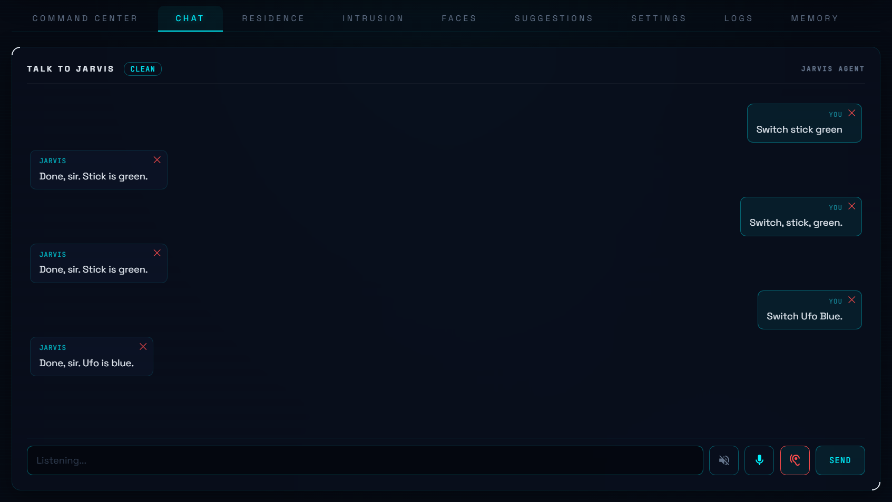

# Clean Jarvis

Clean Jarvis is a patch of [JARVIS AI Assistant](https://github.com/sam3gp8/jarvis-aio) by sam3gp8, published under the same MIT licence. The assistant is still JARVIS, with the same functions and calm voice. Clean Jarvis changes how honest and private it is.

## What is different

**It does not invent things**
- A cleaned personality: truth first, with no made-up house details or backstory.
- Spoken briefings read real facts only.
- On a device command, JARVIS may only say it worked if a device tool really ran. A failed or unconfirmed action is reported as such.

**Privacy between people**
- Chat history, memory, facts, follow-ups and goals are separated per person, automatically for new users. Reminders are shared by the household and are announced to the whole house.
- Non-admin logins keep normal household use, but cannot reach admin actions, mail, or other people's data.
- Face snapshots are no longer stored in the public web folder.

**Better day to day**
- Clearer device matching: a vague name asks which device you mean instead of guessing.
- Chat tab with saved history, press-to-talk, read-aloud, a thinking indicator and cancel.
- Energy questions: "how much electricity did we use this month?" reads the Energy dashboard for that period and names the biggest users. JARVIS says what the total covers: without a whole-house meter it is only the monitored devices.
- Power right now: "what is the power consumption?" without a whole-house meter adds up what the devices on the Energy dashboard draw right now, read live, and says the house draws more. An energy or power figure is never repeated from an earlier answer.
- Phone layout: the header, the chat box and the Faces, Logs and Suggestions tabs fit a phone screen; the desktop layout is unchanged.
- Lamp effects and scenes: "set the lamp to Blue sky" starts that lamp's own effect or scene by name, read from the lamp's effect list, without the AI. "Done" only when the lamp reports it.
- Camera tab: a camera in an unlit room is shown with a "VERY DARK — too little light to see" notice instead of "NO FRAME". Slow or dropped pictures on a phone connection do not end the picture, and a camera that comes back after an outage reappears by itself within about a minute.

**Voice control**

- Hey JARVIS switch in the Chat tab: JARVIS listens through your computer microphone on the web page and waits for "Hey Jarvis" before taking a command. Off by default, remembered per browser, and the audio goes only to your own Home Assistant.
- After "Hey Jarvis" you can pause before the command: the page waits for you to start and stops after a real pause. The button stays red while it listens. When nothing is said, nothing is sent.
- Listening pauses during hold to talk and while JARVIS speaks.
- Punctuation from speech recognition never changes a command: "Switch, lamp, green." works like "switch lamp green". Numbers and times such as 21.5 and 7:30 keep their marks.
- Device names that only sound alike are still found, so a misheard "fone" finds Phone. If two devices both sound right, JARVIS asks which one you mean.

## Install

Requires Home Assistant 2026.11 or newer, which includes the Marketplace.

**If you already have the original JARVIS**, make a backup, then remove it first. The Marketplace will not install over it:

1. Go to **Settings > Devices & services**, open JARVIS and delete it.
2. Go to **Settings > Marketplace**, open JARVIS and uninstall it.

**Then install Clean Jarvis:**

1. Go to **Settings > Marketplace**.
2. Select **Add from link** in the upper-right corner. Connect GitHub if asked.
3. Enter `https://github.com/ZoutMax/Clean-Jarvis`, then install it as an integration.
4. Restart Home Assistant.
5. If JARVIS does not appear under **Settings > Devices & services**, add it there.

In our test, stored facts survived this swap. Clean Jarvis uses the same internal name as the original, so you can only have one of them. New chat data is stored in a newer format, so going back to the original later may not keep everything.

## Voice setup

The Chat tab's voice buttons use Home Assistant's own voice assistant. The apps below are not part of Clean Jarvis; install them once:

1. Go to **Settings > Apps** and install **Whisper** (speech to text), **Piper** (text to speech) and **openWakeWord**. Start all three.
2. Go to **Settings > Voice assistants**, open the assistant that uses JARVIS as its conversation agent, and set Speech-to-text, Text-to-speech and Wake word (**Hey Jarvis** is built in).
3. In the JARVIS panel, open the Chat tab and click the ear button. Allow the microphone when the browser asks. The page must be opened over https for the microphone to work.

**Plain "Jarvis" instead of "Hey Jarvis"** (optional): download `jarvis_v2.tflite` from [the community wake word collection](https://github.com/fwartner/home-assistant-wakewords-collection/tree/main/en/jarvis) (MIT licence) and put it in the `/share/openwakeword/` folder with the File editor or Samba share app (Settings > Apps), restart the openWakeWord app, then choose **jarvis** as the wake word in step 2. This model reacts to both "Jarvis" and "Hey Jarvis".

## Settings

Everything below is done in Home Assistant's own screens, in a browser or in the Home Assistant phone app. No files, terminal or YAML are needed.

**Clean Jarvis switches**: Settings > Devices & services > JARVIS > Configure > Core.
- *Check that actions really ran* (on by default): JARVIS only says a device action worked when a device tool really ran.
- *Block actions after reading an email* (on by default): after JARVIS has read mail, he does not act on the home for the rest of that request.
- *Scheduled briefings use real facts only* (on by default): the morning and evening briefings read out facts, without AI-written text.
- *Camera Watch opens on this camera*: the camera the Camera tab shows first.

**People and privacy**: Settings > People. Every person with a login automatically gets their own chat history, memory, facts, follow-ups and goals. Switch *Administrator* off for someone who should use the house (devices, questions, reminders) but not admin actions, mail or other people's data.

**Device names**: change a name or add aliases on the device or entity in Settings > Devices & services. Settings > Voice assistants > Expose chooses which devices JARVIS may control. JARVIS also remembers corrections you give him in the chat.

**Energy questions**: JARVIS answers "how much did we use this month?" from the Energy dashboard. Add your meter or devices in Settings > Dashboards > Energy. Without a whole-house meter he says the total covers only the monitored devices. "What is the power consumption?" reads the power sensors of those devices; a device's power sensor is its power entry on the Energy dashboard, otherwise the one power sensor on the same device.

**Voice**: see Voice setup above. Hey JARVIS on or off: the ear button in the JARVIS Chat tab, remembered per browser.

**Everything else** (AI model, briefing times, quiet hours, cameras, learning, energy, notifications): the Settings tab in the JARVIS panel and Settings > Devices & services > JARVIS > Configure, the same as in the original JARVIS.

**Remove Clean Jarvis**: Settings > Devices & services > JARVIS > Delete, then Settings > Marketplace > JARVIS > Uninstall.

## Updates

Clean Jarvis follows the original project. Updates appear in **Settings > Updates**; install them there with one click. JARVIS data and settings are kept. Home Assistant checks repositories added by link every 48 hours.

### How Clean Jarvis follows JARVIS

Every Saturday a GitHub job ([upstream-sync.yml](.github/workflows/upstream-sync.yml)) looks for a new release of the original JARVIS. When there is one it:

1. applies the Clean Jarvis patch ([patches/apply.py](patches/apply.py)) to that release; every change must fit exactly, or nothing is built;
2. runs the patch tests ([patches/tests](patches/tests)) on the result, then every check of the project (audit, unit tests, a real Home Assistant start, hassfest, HACS, the panel smoke test);
3. publishes it as the next Clean Jarvis release: the original release plus one Clean Jarvis commit.

If the patch no longer fits or a check fails, nothing is published and an issue in this repository says what needs attention. [patches/UPSTREAM](patches/UPSTREAM) names the JARVIS release the current version is built on.

The job publishes with a repository secret `CJ_RELEASE_TOKEN`: a fine-grained token for this repository only, with Contents and Workflows set to read and write (GitHub does not let its own job token publish changes to workflow files).

## Known limits

- The truth check covers device commands. A false statement in ordinary chat is only guarded by the personality and live facts.
- The truth check reads English and Dutch replies. An unusual phrasing can be asked back once, and a very unusual one can slip through.
- Camera tab on a slow connection (about 3G speed): a camera that sends large pictures can end on "NO FRAME". It is tried again about once a minute.
- Bare phrases such as "lights off" are not always recognised as commands.
- Hey JARVIS uses the wake word set in your Home Assistant voice assistant (openWakeWord "hey_jarvis"). A plain "Jarvis" wake word is not included.
- Everything here runs with full access to your Home Assistant. As with all community projects, review it before you use it.

Please report issues about these changes here, not to the original project.

## Credit

All original work is by [sam3gp8](https://github.com/sam3gp8). See [LICENSE](LICENSE).
